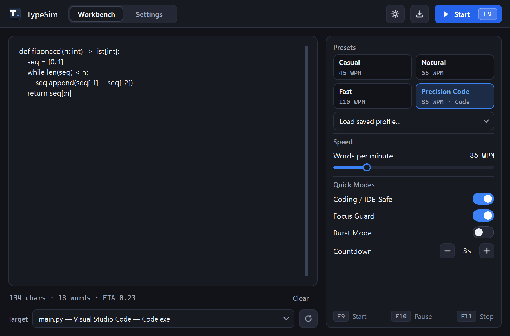
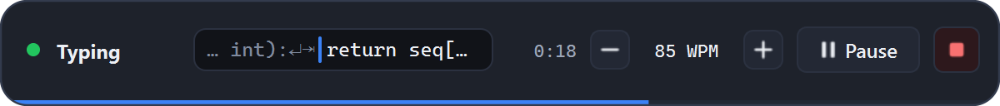
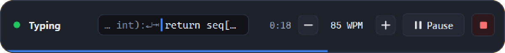

<div align="center">


# TypeSim

**Natural, human-indistinguishable keyboard simulation for Windows 10 & Windows 11.**

[](https://github.com/Raincl-oud/TypeSim/releases/latest)
[](https://github.com/Raincl-oud/TypeSim/actions/workflows/release.yml)
[](https://www.python.org/downloads/)
[](https://www.microsoft.com/windows)
[](#privacy--security-notes)
[](LICENSE)

[**Download Portable `.exe`**](https://github.com/Raincl-oud/TypeSim/releases/latest) · [**Highlights**](#highlights) · [**Presets**](#built-in-presets) · [**Shortcuts**](#keyboard-shortcuts) · [**Run from Source**](#getting-started) · [**Architecture**](#architecture)

<br />

<picture>
  <source media="(prefers-color-scheme: dark)" srcset="assets/readme/workbench-dark.png" />
  <source media="(prefers-color-scheme: light)" srcset="assets/readme/workbench-light.png" />
  
</picture>

<sub>Split Workbench — automatically adapts between Dark and Light themes to match your Windows appearance.</sub>

</div>

---

## Floating Dynamic Pill HUD

When typing starts, TypeSim tucks out of your way and surfaces a frameless, non-activating (`WS_EX_NOACTIVATE`) floating pill — clicking **Pause**, stepping **WPM**, or hitting **Stop** never steals keyboard focus from your target app.

| Active Typing (`TYPING`) | Focus Guard Triggered (`FOCUS_LOST`) |
| :---: | :---: |
|  |  |
| <sub>Live 1-line preview, session-only WPM stepper, O(1) ETA & progress bar</sub> | <sub>Auto-pauses instantly if focus leaves your target window</sub> |

---

## Why TypeSim?

Unlike basic macro tools that paste bulk strings or fire robotic fixed-interval keystrokes, **TypeSim** models how people actually type, hesitate, make physical key-neighbor mistakes, and recover — while keeping your active window and clipboard safe.

| Capability | Typical Auto-Typers | **TypeSim** |
| :--- | :--- | :--- |
| **Keystroke Timing** | Flat constant delay or uniform random noise | Clamped Gaussian rhythm + punctuation, Shift, word & paragraph cadence |
| **Typo Simulation** | Random `a–z` characters or none | Physical **QWERTY-adjacent** misses, 1-char overshoots, transpositions & double-taps |
| **Unicode & Emojis** | Overwrites your system clipboard per char | Direct Win32 `SendInput` (`KEYEVENTF_UNICODE` UTF-16LE surrogate pairs) — **clipboard untouched** |
| **Wrong-Window Safety** | Keeps typing blindly if a popup steals focus | **HWND Focus Guard** auto-pauses immediately + **Focus & Resume** countdown |
| **IDE / Live Coding** | Breaks on IDE auto-indent & typos brackets | **Coding / IDE-Safe Mode** skips symbol typos & clears GUI IDE auto-indent cleanly |
| **Global Hotkeys** | Low-level hook leaks `F10` / `F11` into apps | Native Win32 `RegisterHotKey` **intercepts & consumes** hotkeys cleanly (zero `pynput`) |
| **Pause / Stop Latency** | Blocks until `sleep()` finishes | `< 20 ms` `HybridSleeper` instant response |

---

## Highlights

### 1. Human Cadence & QWERTY Realism
- **Contextual Rhythm**: Configurable `10–400 WPM` with Gaussian variation, subtle slowdowns on uppercase/shifted symbols and word transitions, natural micro-pauses on `, ; :` and `. ! ?`, and longer breaths across paragraph breaks.
- **Physical QWERTY Error Model**: Preserves letter casing across weighted human typo patterns — adjacent-key misses (`70%`, with occasional `1-char` overshoot before backspacing twice), adjacent-letter transpositions (`20%`), and accidental double-taps (`10%`).
- **Bursts & Cognitive Pauses**: Optional burst-typing cycles and probabilistic thinking pauses at word boundaries.
- **O(1) Realistic ETA**: Precomputes suffix cost tables so live ETA accounts for punctuation cadence, typo corrections, bursts, and thinking pauses — even on long documents.

### 2. Native Win32 Input & Focus Guard
- **Zero-Clipboard Unicode**: Dispatches 64-bit Win32 `SendInput` batches directly as UTF-16LE code units (including non-BMP emojis like `😀` or `𝄞`), keeping an optional clipboard mode solely for legacy remote-desktop targets.
- **HWND Target Locking**: Tracks windows by native `HWND` (`Title — process.exe`) rather than fragile title strings, and warns inline if you select an Administrator window blocked by Windows UIPI.
- **Focus Guard**: Monitors foreground focus before every action; if focus drifts, TypeSim pauses cleanly without losing mid-typo correction state.

### 3. Coding / IDE-Safe Mode
- **Symbol & Indentation Protection**: Suppresses simulated typos on brackets, quotes, operators, punctuation, and leading whitespace.
- **Terminal-Aware Auto-Indent Clearing**: Clears IDE-inserted leading whitespace after newlines via `Shift+Home → Space → Backspace` in GUI editors (VS Code, JetBrains, Sublime, Notepad++), while automatically skipping terminal processes (`WindowsTerminal.exe`, `pwsh.exe`, `powershell.exe`, `cmd.exe`, `alacritty.exe`, `wezterm-gui.exe`).

### 4. Modern PyQt6 Workbench, Tray Standby & Silky Motion
- **Adaptive Light & Dark UI**: Follows Windows system appearance live (`WM_SETTINGCHANGE`) with a 1-click header toggle, crisp vector iconography, and WCAG AA contrast.
- **System Tray Standby**: Minimize TypeSim to the tray and trigger typing anytime via your global hotkey; the tray icon displays live state badges (green while typing, amber while paused or counting down).
- **Smooth, Reduced-Motion-Aware Craft**: Directional view transitions, staggered Settings cards, smooth preset slider glides, magnetic 6-anchor HUD edge-snap, and automatic fallback when Windows *Animation effects* are disabled.

---

## Built-in Presets

Presets tune realism behavior in one click without overwriting your custom hotkeys, window preferences, or theme. Custom user profiles are saved atomically in `~/.typesim/profiles.json` (backward-compatible with TypeSim v1.1).

| Preset | Speed | Variation | Typo Rate | Correction Delay | Thinking Pause | Coding Mode | Best For |
| :--- | :---: | :---: | :---: | :---: | :---: | :---: | :--- |
| **Casual** | `45 WPM` | `28%` | `4.0%` | `0.22s` | `3.0%` (`0.7–2.5s`) | Off | Relaxed drafting & conversational notes |
| **Natural** *(Default)* | `65 WPM` | `20%` | `2.5%` | `0.15s` | `2.0%` (`0.5–2.0s`) | Off | Everyday articles, docs, web forms |
| **Fast** | `110 WPM` | `15%` | `1.5%` | `0.10s` | `1.0%` (`0.3–1.2s`) | Off | Experienced touch-typist pace |
| **Precision Code** | `85 WPM` | `12%` | `0.0%` | `0.10s` | `0.5%` (`0.3–1.0s`) | **On** | Live IDE demos, snippets & structured code |

---

## Keyboard Shortcuts

### Global Hotkeys (Customizable via Click-to-Record in Settings)

Supports single keys (`F1–F24`, `Home`, `Insert`, `Pause`, etc.) and modifier combinations (`Ctrl+Shift+F9`, `Alt+F10`).

| Default | Action | Behavior |
| :--- | :--- | :--- |
| <kbd>F9</kbd> | **Start / Focus & Resume** | Starts typing, resumes manual pause (`0s`), or refocuses target + runs resume countdown after Focus Lost |
| <kbd>F10</kbd> | **Pause / Resume** | Toggles pause instantly (`< 20 ms`) without leaking menu-bar focus into the target app |
| <kbd>F11</kbd> | **Stop** | Aborts countdown or typing immediately without toggling browser/IDE fullscreen |

### Compose Editor Shortcuts

| Shortcut | Action |
| :--- | :--- |
| <kbd>Ctrl</kbd> + <kbd>Backspace</kbd> / <kbd>Ctrl</kbd> + <kbd>Delete</kbd> | Delete previous / next word |
| <kbd>Shift</kbd> + <kbd>Delete</kbd> | Delete entire current line |
| <kbd>Ctrl</kbd> + <kbd>Z</kbd> / <kbd>Ctrl</kbd> + <kbd>Y</kbd> | Undo / Redo |
| <kbd>Ctrl</kbd> + <kbd>A</kbd> / <kbd>Ctrl</kbd> + <kbd>X</kbd> / <kbd>C</kbd> / <kbd>V</kbd> | Select all, Cut, Copy, Paste |

---

## Getting Started

### Option A — Portable Executable (Recommended)

1. Download **`TypeSim.exe`** from the [**Latest Release**](https://github.com/Raincl-oud/TypeSim/releases/latest).
2. Run `TypeSim.exe` directly — no installer, Python runtime, or Administrator privilege required.

### Option B — Run from Source

**Prerequisites:** Windows 10 or Windows 11 · Python **3.12+**

```powershell
git clone https://github.com/Raincl-oud/TypeSim.git
cd TypeSim
python -m venv .venv
.venv\Scripts\Activate.ps1
pip install -r requirements.txt
python main.py
```

### Running the Test Suite

```powershell
$env:QT_QPA_PLATFORM = "offscreen"
python -m unittest discover -s tests -v
```

### Building a Standalone `.exe`

```powershell
pip install pyinstaller
python -m PyInstaller --noconfirm --clean --onefile --windowed --name TypeSim `
  --icon assets/typesim.ico --add-data "assets/typesim.ico;assets" `
  --exclude-module tkinter --exclude-module pynput --exclude-module tests --exclude-module tools `
  --exclude-module PyQt6.QtBluetooth --exclude-module PyQt6.QtDBus --exclude-module PyQt6.QtDesigner `
  --exclude-module PyQt6.QtHelp --exclude-module PyQt6.QtMultimedia --exclude-module PyQt6.QtMultimediaWidgets `
  --exclude-module PyQt6.QtNetwork --exclude-module PyQt6.QtNfc --exclude-module PyQt6.QtOpenGL `
  --exclude-module PyQt6.QtOpenGLWidgets --exclude-module PyQt6.QtPositioning --exclude-module PyQt6.QtPrintSupport `
  --exclude-module PyQt6.QtQml --exclude-module PyQt6.QtQuick --exclude-module PyQt6.QtQuick3D `
  --exclude-module PyQt6.QtQuickControls2 --exclude-module PyQt6.QtQuickWidgets --exclude-module PyQt6.QtRemoteObjects `
  --exclude-module PyQt6.QtSensors --exclude-module PyQt6.QtSerialPort --exclude-module PyQt6.QtSpatialAudio `
  --exclude-module PyQt6.QtSql --exclude-module PyQt6.QtStateMachine --exclude-module PyQt6.QtSvgWidgets `
  --exclude-module PyQt6.QtTest --exclude-module PyQt6.QtTextToSpeech --exclude-module PyQt6.QtWebChannel `
  --exclude-module PyQt6.QtWebSockets --exclude-module PyQt6.QtXml --exclude-module PyQt6.QtWebEngineCore `
  --exclude-module PyQt6.QtWebEngineWidgets main.py
```

The portable executable is output to `dist\TypeSim.exe` (~35 MB).

---

## Architecture

```text
TypeSim/
├── main.py                  # Thin PyQt6 launcher, HiDPI policy & AppUserModelID
├── assets/
│   ├── typesim.ico          # 7-size Tactile 3D Keycap icon (DIB 16–128px + PNG 256px)
│   └── readme/              # Adaptive Dark/Light & HUD preview screenshots
├── typesim/
│   ├── config.py            # TypingSettings + AppPreferences + atomic JSON persistence
│   ├── profiles.py          # Built-in presets & backward-compatible profile CRUD
│   ├── engine.py            # Zero-Qt state machine, HybridSleeper, cadence & QWERTY typos
│   ├── estimator.py         # O(1) suffix-array session ETA calculator
│   ├── win32_input.py       # 64-bit ctypes SendInput, HWND enumeration, focus & UIPI checks
│   ├── hotkey_parser.py     # Qt-free hotkey grammar parser & validator
│   ├── hotkeys.py           # Win32 RegisterHotKey manager via QAbstractNativeEventFilter
│   └── ui/                  # Theme palettes, vector icons, silky motion, Workbench, HUD & Tray
├── tools/
│   └── build_icon.py        # Deterministic multi-resolution .ico generator
└── tests/                   # 35 unit & offscreen UI verification tests
```

---

## Privacy & Security Notes

> [!NOTE]
> **Ephemeral Compose Buffer & 100% Offline:** Text pasted or written in the editor stays strictly in memory during your session and is **never written to disk**. TypeSim makes zero network calls and collects zero telemetry.

> [!IMPORTANT]
> **Administrator Windows (UIPI) & IDE Auto-Closing Pairs:**
> - Windows User Interface Privilege Isolation blocks standard-user processes from injecting input into elevated (*Run as Administrator*) windows. TypeSim detects elevated targets and displays a warning banner; run TypeSim as Administrator only when targeting an elevated app.
> - In **Coding / IDE-Safe Mode**, IDE auto-closing brackets/quotes (`{}`, `()`, `""`) remain governed by your editor's settings — disable *Auto Closing Brackets/Quotes* in your IDE when typing multi-line nested blocks verbatim.

---

## License

Released under the [MIT License](LICENSE).
